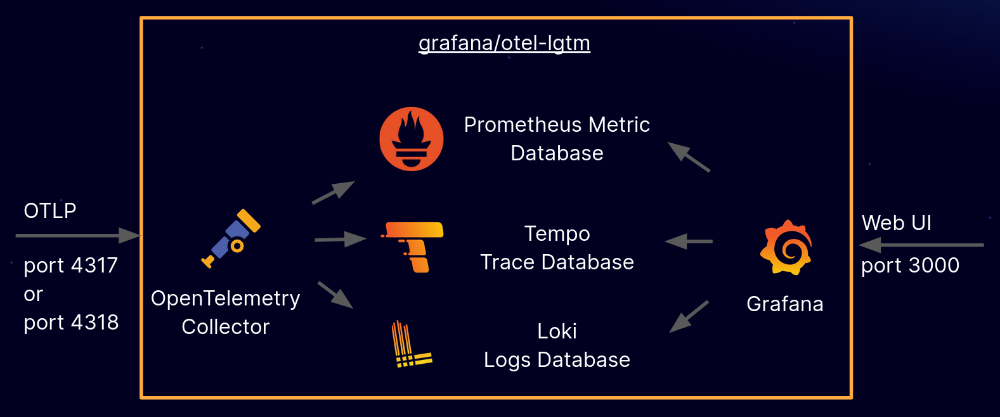

# Guide de déploiement Lutece sur Kubernetes — plusieurs réplicas


Ce guide déploie un site Lutece 8 (socle Forms) sur Kubernetes, avec le runtime Open Liberty, une base MariaDB et
l'observabilité de la suite Grafana OTel LGTM.

Cette branche (`multi-instance`) fait tourner le site en **plusieurs réplicas** derrière un répartiteur : la session HTTP
et le cache Lutece sont partagés par Hazelcast, embarqué dans chaque pod. L'affinité de session de l'ingress est
recommandée, pas indispensable (voir les mesures). Pour une seule
instance, plus simple, voir la branche
[`mono-instance`](https://github.com/lutece-platform/lutece-guide-kubernetes-lutece/tree/mono-instance).

**Le guide pas à pas, avec le détail de chaque fichier : [INSTALL.md](INSTALL.md)**

## Table des matières

1. [Avant de passer en multi-instance](#avant-de-passer-en-multi-instance)
2. [Prérequis](#prérequis)
3. [Démarrage rapide](#démarrage-rapide)
4. [Architecture](#architecture)
5. [Le site](#le-site)
6. [Déploiement sur Kubernetes](#déploiement-sur-kubernetes)
7. [Réglages](#réglages)
8. [Observabilité](#observabilité)
9. [Dépannage](#dépannage)

## Avant de passer en multi-instance

Tous les sites ne peuvent pas tourner en plusieurs réplicas. Chaque plugin du site doit le supporter : état gardé dans
la base, la session ou le cache Lutece (jamais dans un champ statique), objets de session et de cache sérialisables,
daemons qui ne s'exécutent pas deux fois. Les plugins du BOM de la plateforme Lutece 8.0.0-beta-04 et suivantes sont
corrigés pour cela ; un plugin développé hors de la plateforme doit être vérifié avant. Un site qui en embarque un qui
ne le supporte pas reste sur la branche `mono-instance`.

## Prérequis

- Java 21 et Maven 3.9 ou plus
- Git
- Docker (ou Podman)
- Minikube et kubectl ; addon `ingress` de minikube pour le répartiteur

## Démarrage rapide

```sh
git clone -b multi-instance https://github.com/lutece-platform/lutece-guide-kubernetes-lutece.git
cd lutece-guide-kubernetes-lutece

# War du site (profil cluster, actif par défaut : Hazelcast dans le war), puis image dans le Docker de minikube
mvn clean lutece:site-assembly -Pcontainer-runtime
eval $(minikube docker-env)
docker build -t lutece-guide-kubernetes:multi-1.0.0-SNAPSHOT .

# Base de données, observabilité, ressources communes du site
kubectl apply -f deploy/k8s/mariadb-manifest.yaml
kubectl rollout status deployment/mariadb
kubectl apply -f deploy/k8s/lgtm.yaml
kubectl apply -f deploy/k8s/lutece-base.yaml

# Migrations Liquibase depuis un seul pod, puis les réplicas
kubectl apply -f deploy/k8s/lutece-migration.yaml
kubectl rollout status deployment/lutece-liquibase --timeout=10m
kubectl delete -f deploy/k8s/lutece-migration.yaml
kubectl apply -f deploy/k8s/lutece.yaml
kubectl rollout status deployment/lutece-deployment --timeout=5m

# Répartiteur
minikube addons enable ingress
kubectl apply -f deploy/k8s/lutece-ingress.yaml
```

- Site : `http://lutece.local/lutece/` (ajouter `<minikube ip> lutece.local` dans `/etc/hosts`), ou
  `http://<minikube ip>:31000/lutece/` (NodePort)
- Back office : `.../lutece/jsp/admin/AdminLogin.jsp` (admin / adminadmin, mot de passe à changer à la première
  connexion). Le back office exige HTTPS sur une autre adresse que `localhost` (en-tête CSP
  `upgrade-insecure-requests`) : pour un test en HTTP, `kubectl port-forward service/lutece-service 9090:9090` et
  `http://localhost:9090/lutece/`.
- Grafana : `kubectl port-forward service/lgtm 3000:3000`, puis `http://localhost:3000` (admin / admin)

## Architecture

```
                ingress-nginx (rejeu sur erreur de connexion seulement)
                 /                                   \
   pod lutece-deployment                      pod lutece-deployment
   ┌──────────────────────────┐               ┌──────────────────────────┐
   │ Open Liberty + Lutece    │               │ Open Liberty + Lutece    │
   │  session : sessionCache  │               │  session : sessionCache  │
   │  cache   : client HZ     │               │  cache   : client HZ     │
   │            + near cache  │               │            + near cache  │
   │ membre Hazelcast :5701 ◄─┼───────────────┼─► membre Hazelcast :5701 │
   └──────────┬───────────────┘    cluster    └──────────┬───────────────┘
              │                 lutece-guide             │
              ├──────── MariaDB (tables, Quartz) ────────┤
              └──── volume ReadWriteMany (index Forms) ──┘
```

- **Session HTTP** : `sessionCache-1.0` d'Open Liberty sur le membre Hazelcast du pod. Les membres se découvrent par
  l'API Kubernetes (Service `lutece-guide-hazelcast`).
- **Cache Lutece** (JCache) : client Hazelcast connecté au membre de son pod, avec un near cache (copie locale des
  entrées lues, invalidée à chaque modification).
- **Daemons** : `plugin-quartz-scheduler` en cluster ; un daemon qui modifie des données partagées ne tourne que sur un
  réplica.
- **Base** : migrations Liquibase depuis un seul pod (`lutece-migration.yaml`), jamais par les réplicas.
- **Index Lucene de Forms** : sur un volume partagé par tous les réplicas.

## Le site

| Fichier | Rôle |
|---|---|
| `pom.xml` | BOM et `forms-starter` de la plateforme, `plugin-health`, `plugin-quartz-scheduler` ; profil `cluster` (par défaut : Hazelcast, `library-cache-hazelcast`, Ehcache retiré) et profil `local` (`-Dlocal`) |
| `src/main/liberty/config/server.xml` | Features, pool de threads borné, connexions persistantes, adresse du client, source de données, inclusion de `cluster.xml` |
| `src/main/liberty/config/cluster.xml` | `sessionCache-1.0`, bibliothèque de session, provider JCache Hazelcast du cache Lutece |
| `src/main/liberty/config/hazelcast-config-api-mode.yaml` | Membre : nom du cluster, arrêt gracieux, invalidations immédiates, découverte Kubernetes |
| `src/main/liberty/config/hazelcast-client-config-api-mode.yaml` | Client du cache Lutece : membre du pod, near cache |
| `src/main/liberty/config/jvm.options` | Membre Hazelcast, nom du Service de découverte, accès aux API internes de Java |
| `webapp/WEB-INF/conf/override/profiles-config.properties` | Liquibase, Quartz en cluster et daemons exclusifs, index Forms, cache |
| `webapp/WEB-INF/plugins/plugins.dat` | Plugins installés sur une base neuve |

En local, le site tourne en une instance avec Ehcache : `mvn liberty:run -Dlocal` (MariaDB local initialisé par
`deploy/sql/init.sql`).

## Déploiement sur Kubernetes

| Fichier | Ressources |
|---|---|
| `deploy/k8s/mariadb-manifest.yaml` | MariaDB 11.8 (UTC, utf8mb4), volume, Service `mariadb-service` |
| `deploy/k8s/lutece-base.yaml` | Secret, ConfigMap du profil, compte de service, Role et RoleBinding de découverte Hazelcast, Service Hazelcast, volume ReadWriteMany de l'index Forms, Service NodePort 31000 |
| `deploy/k8s/lutece-migration.yaml` | Pod unique qui lance les migrations Liquibase |
| `deploy/k8s/lutece.yaml` | Deployment, 2 réplicas |
| `deploy/k8s/lutece-ingress.yaml` | Ingress ingress-nginx |
| `deploy/k8s/lgtm.yaml` | Grafana OTel LGTM |

Avant chaque nouvelle image : relancer `lutece-migration.yaml` avec cette image, puis mettre à jour `lutece.yaml`.

## Réglages

Mesurés sur minikube et podman avec 2 et 3 réplicas, sous charge (k6) et parcours de formulaire complets (Playwright).

| Réglage | Valeur | Pourquoi |
|---|---|---|
| Bibliothèque de session | tous les jars du war | Le membre héberge aussi les caches Lutece : sans les classes Lutece, migration des partitions impossible, sessions perdues au redémarrage progressif |
| `writeContents` | `GET_AND_SET_ATTRIBUTES` | La valeur par défaut ne réplique pas les beans `@SessionScoped` modifiés en place (formulaires en plusieurs étapes) |
| Near cache | `OBJECT`, `time-to-live-seconds: 600` | Sans near cache : 2,2 req/s contre 37 ; `BINARY` coûte un tiers de CPU en plus |
| Near cache de `formsCacheService` | `BINARY` | Forms modifie les objets qu'il lit dans son cache : chaque lecture doit rendre une copie (sinon `ConcurrentModificationException` sur la multivue) ; +5 % de CPU |
| Caches Lutece côté membre | aucune déclaration | Une entrée qui s'applique aux caches de session d'OpenLiberty (`"*"`, `com.ibm.ws.session.*`) doit déclarer leurs types exacts (clé `String`, valeur `ArrayList` pour `meta`, `byte[]` pour `attr`) : sinon le cluster ne démarre plus de zéro (SESN0307E, types de clé incompatibles) |
| Sauvegarde des sessions | synchrone (défaut) | Copie asynchrone (`async-backup-count: 1`, types exacts, exemple commenté dans `hazelcast-config-api-mode.yaml`) : pas de gain net mesuré, sessions perdues si un pod tombe |
| Fichiers téléversés | cache `asynchronousUploadFilesCache`, near cache `BINARY` de 50 entrées | Le contenu est écrit une fois au dépôt, la session ne garde que son identifiant (sinon il est réécrit dans Hazelcast à chaque requête) : session d’un parcours abandonné 0,7 Mo au lieu de 16,4 Mo ; durée de vie `asynchronousupload.files.store.timeToLiveSeconds` (24 h par défaut), au-dessus de la plus longue session ; nombre d'entrées (`core.cache.status.asynchronousUploadFilesCache.maxElementsInMemory`, 10 000 par défaut) à dimensionner sur les fichiers en cours de dépôt et la mémoire du cluster : un fichier évincé avant la validation est une erreur pour l'usager |
| Adresse du client | `<remoteIp/>` dans `httpEndpoint` | Derrière l'ingress, sans lui tous les usagers ont l'adresse de l'ingress : l'anti-DOS des téléversements du core (`DosGuardFilter`) refuse leurs dépôts successifs (erreur 500) |
| Taille des caches | `library-cache-hazelcast` | JCache ne transmet pas la taille : sans la bibliothèque, tous les caches sont à 10 000 entrées |
| Invalidations | `hazelcast.cache.invalidation.batch.enabled: false` | Groupées par défaut : une modification met plusieurs secondes à être vue partout |
| Hook d'arrêt JVM | désactivé, arrêt `GRACEFUL` | Le hook fermait le membre pendant que des requêtes étaient en cours : 500 au redémarrage progressif |
| Threads Liberty | 4 pour 2 CPU | Sans borne : 13,5 req/s bornés à 4 contre 5 à 8 req/s sous 40 usagers |
| Ingress | rejeu sur erreur de connexion, délai de connexion 2 s | Pod tué sous charge : p99 2,5 s au lieu de 37 s ; un POST déjà envoyé n'est jamais rejoué |
| Arrêt du pod | `preStop` 10 s, grâce 60 s | Sortir du Service, puis laisser le membre transférer ses partitions |

Mesures de ce guide sur minikube (2 réplicas derrière l'ingress, k6, 20 usagers qui enchaînent sans pause les étapes
d'un formulaire) :

| Passage | Requêtes/s | p50 | p95 | Erreurs | CPU / requête |
|---|---|---|---|---|---|
| JVM chaude | 52,3 | 98 ms | 329 ms | 0 sur 2 369 parcours | 58 ms |
| Redémarrage progressif des 2 pods sous charge | 31,6 | 221 ms | 1,1 s | 1 sur 2 390 parcours | |

Le seul échec est un POST en cours sur le pod arrêté, que l'ingress ne rejoue pas.

Test long, une déclaration en onze étapes (formulaire et workflow construits par la suite e2e `FormsDeontologieSuite` de
lutece-e2e : sept rubriques « Oui / Non », 20 % des déclarants déclarent une rubrique et la moitié d'entre eux ajoutent une
seconde déclaration), k6 à débit d'arrivée fixe, 1 à 3 s de réflexion par étape, 10 min par palier, pods de 1 / 2 CPU :

| Déclarations/min | 1 réplica (branche `mono-instance`) | 2 réplicas, ingress sans affinité | 2 réplicas, ingress avec affinité |
|---|---|---|---|
| 30 | p95 219 ms, 0 échec | p95 277 ms, 0 échec | |
| 60 | p95 472 ms, p99 1,4 s, 0 échec | p95 265 ms, p99 391 ms, 0 échec | |
| 90 | p50 3,3 s, 4 % de déclarations échouées (saturé) | p95 372 ms, p99 694 ms, 0 échec, 116 ms CPU / requête | p95 289 ms, p99 530 ms, 0 échec, 92 ms CPU / requête |
| 120 | p50 6,6 s, 25 % échouées | p95 390 ms, p99 627 ms, 0 échec | |
| 150 | | p95 708 ms, p99 977 ms, 0 échec, 111 ms CPU / requête | p95 542 ms, p99 777 ms, 0 échec, 98 ms CPU / requête |

Chaque réponse enregistrée est retrouvée en base. Sans affinité, chaque requête peut changer de pod : les étapes d'un
formulaire passent (elles répondent sans redirection), mais une requête qui suit une redirection peut arriver sur l'autre
pod avant qu'Open Liberty ait écrit la session (il l'écrit à la fin de la requête, après l'envoi de la redirection) : une
action du back office voit alors un jeton de sécurité périmé (« Invalid security token »). Avec l'affinité (cookie de
l'ingress, nouveau à chaque déclaration), la charge reste répartie à parts égales et le CPU par requête baisse de 12 à 21 %. Parcours Playwright en changeant de
pod à chaque requête : formulaire en deux étapes avec pièce jointe, 6 numérotations simultanées (6 numéros distincts),
session du back office sur 6 pages protégées : tous réussis.

Une donnée modifiée hors de Lutece (script SQL, restauration) reste en cache jusqu'à sa durée de vie (3600 s par défaut)
plus celle du near cache (600 s), même après un redémarrage progressif : vider les caches depuis le back office, ce qui
agit sur tout le cluster. Une préférence d'utilisateur ajoutée par SQL n'est pas vue tant que le cache
`BaseUserPreferencesCacheService` n'est pas vidé (une préférence absente est mise en cache comme absente). Activer ou
désactiver un cache, installer ou désinstaller un plugin depuis le back office s'applique aux autres réplicas en 30 s.

## Observabilité

Identique à la branche `mono-instance` : export OpenTelemetry activé par le Deployment (`OTEL_SDK_DISABLED=false`,
`OTEL_EXPORTER_OTLP_ENDPOINT=http://lgtm:4317`), suite `grafana/otel-lgtm` pour le développement.



## Dépannage

```sh
# Planificateur Quartz en cluster : une ligne par réplica
kubectl exec -it deployment/mariadb -- mariadb -u lutece -psome_password core -e "select INSTANCE_NAME from qrtz_SCHEDULER_STATE"
```

Hazelcast journalise au niveau INFO, que la console d'Open Liberty n'affiche pas par défaut : pour voir la composition
du cluster (`Members {size:2 ...}`), ajouter `WLP_LOGGING_CONSOLE_LOGLEVEL=INFO` aux variables du Deployment.

- Un pod qui reste seul dans son cluster : vérifier le Role et le RoleBinding de `lutece-base.yaml`, et que
  `hz.service-name` (`jvm.options`) est le nom du Service Hazelcast.
- Un pod qui ne démarre pas sur une base neuve : les migrations n'ont pas été lancées (`lutece-migration.yaml`).
- Un pod tué pendant une migration laisse `DATABASECHANGELOGLOCK` verrouillé : arrêter tous les pods, libérer le verrou,
  relancer la migration.

## Licence

[Licence du projet](LICENSE)

## Documentation

- [Lutece](https://lutece.paris.fr/support/) ; [plateforme Lutece : BOM et starters](https://github.com/lutece-platform/lutece-platform)
- [Open Liberty : sessions en cache JCache](https://openliberty.io/docs/latest/distributed-session-caching.html)
- [Hazelcast : near cache](https://docs.hazelcast.com/hazelcast/latest/cluster-performance/near-cache),
  [découverte Kubernetes](https://docs.hazelcast.com/hazelcast/latest/kubernetes/kubernetes-auto-discovery)
- [MicroProfile Config 3.1](https://microprofile.io/specifications/config/3-1/),
  [Health 4.0](https://microprofile.io/specifications/health/4-0/),
  [Telemetry 2.0](https://microprofile.io/specifications/telemetry/2-0/)
- [OpenTelemetry](https://opentelemetry.io/docs/), [Grafana](https://grafana.com/docs/)
